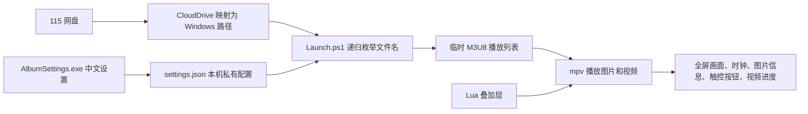

# Local Album Frame 实施与维护 SOP

## 1. 项目目标

Local Album Frame 是给 Windows 平板和掌机使用的本地电子相框。它不会修改桌面壁纸，也不会直接登录网盘。照片和视频先由 CloudDrive 一类工具映射成 Windows 可读目录，电子相框只读取这个目录。

本项目在保留原相册软件的前提下单独建设，便于试用、回退和后续发布。它使用 mpv 作为播放引擎，用 PowerShell 组织播放列表和启动流程，用 C# / WPF 提供简体中文设置窗口，用 Lua 实现时钟、图片信息、触控按钮和视频进度条。

## 2. 需求与设计结论

- 递归读取指定目录及所有子目录，图片和视频可以放在不同层级。
- 支持随机播放、按名称顺序播放、图片停留秒数和整组循环。
- 视频按自身时长播放，可选择是否播放声音。
- 时钟显示时间、日期和星期，并可在媒体切换时变换角落。
- 左上角图片信息显示序号、总数、文件名、宽高和修改日期，只保留文字，不使用半透明黑色背景框。
- 轻点画面后一次性显示所有大按钮，再点空白区域隐藏；没有常驻菜单按钮。
- 视频平时只显示底部约 4 个物理像素高的进度线，点击底部区域后展开可拖动进度条，松手时只执行一次跳转。
- 设置窗口、按钮和提示均使用简体中文，并针对触控屏扩大点击区域。
- 重复启动时先通知旧播放器退出，避免两个实例同时读网盘和播放声音。
- 不上传媒体、不生成缩略图、不批量探测视频；运行时只读取文件名和当前播放文件。

## 3. 架构与数据流

CloudDrive 与电子相框互相独立。CloudDrive 负责把远端文件呈现为普通 Windows 路径；电子相框不保存 115 账号、Cookie 或密码，也不知道目录背后是不是网盘。

## 4. 目录说明

| 路径 | 用途 | 是否提交 GitHub |
| --- | --- | --- |
| `Launch.ps1` | 校验配置、递归扫描、生成播放列表并启动 mpv | 是 |
| `AlbumSettings.cs`、`Settings.xaml` | 中文 WPF 设置窗口源码 | 是 |
| `Build-UI.ps1` | 使用 Windows 自带 .NET Framework 编译设置窗口 | 是 |
| `portable_config/` | mpv 配置、按键和 Lua 交互脚本 | 是 |
| `Install-Mpv.ps1` | 下载并校验 mpv 官方持续集成构建 | 是 |
| `settings.example.json` | 无个人路径的配置样例 | 是 |
| `settings.json` | 本机目录和个人偏好 | 否 |
| `player/` | mpv、FFmpeg 等第三方二进制 | 否 |
| `runtime/` | 临时播放列表，可能含个人文件路径 | 否 |
| `ui/` | 本机编译产物 | 否 |

## 5. 首次安装

1. 将源码放到一个独立目录，例如 `C:\\Apps\\LocalAlbumFrame`。
2. 运行 `Install-Mpv.ps1`。脚本从 mpv 官方页面所链接的持续集成发布中取得 Windows x64 完整构建，下载后比对发布资产提供的 SHA256；如果 `player/mpv.exe` 已存在则停止，不覆盖现有版本。
3. 运行 `Build-UI.ps1`，生成 `ui/AlbumSettings.exe`。也可直接运行 `Settings.ps1`，缺少设置程序时会自动编译。
4. 运行 `Create-Shortcuts.ps1 -Desktop`，在桌面创建“新版电子相册（试用）”入口，并在项目目录生成随机、顺序和仅图片入口。
5. 打开设置窗口，选择 Windows 可读目录，设置播放顺序、图片秒数、视频、声音、时钟和图片信息，然后点击“保存并开始播放”。

## 6. 网盘挂载使用顺序

1. 启动 CloudDrive 桌面客户端。
2. 确认目标盘符或目录已经出现，并能在资源管理器中打开。
3. 再启动电子相册。
4. 如果提示“相册目录不可访问”，先恢复 CloudDrive 挂载，不要反复重装电子相册。

电子相框每次启动时重新枚举目录，所以以后新增的子文件夹会自动进入下一次播放。运行过程中不会持续扫描整个目录。

## 7. 播放与触控

| 操作 | 结果 |
| --- | --- |
| 轻点画面 | 显示或隐藏全部大按钮 |
| 左 / 右方向键或滚轮 | 上一项 / 下一项 |
| 空格 | 暂停或继续 |
| 点击“设置”或按 `S` | 暂停并打开设置窗口 |
| `M` | 打开或关闭视频声音 |
| `C` | 显示或隐藏时钟 |
| `F` | 切换全屏 |
| `Esc` | 退出相册 |
| 点击视频底部 | 展开进度条 |
| 拖动进度圆点后松手 | 跳转到目标位置 |

设置窗口关闭而不保存时，会回到原来的暂停状态。保存后旧播放器退出，新配置重新启动。为减少远端视频重复读取，拖动过程中只更新预览位置，松手时才执行一次精确跳转。

## 8. 配置项

`settings.json` 由设置窗口维护，关键字段如下：

| 字段 | 含义 |
| --- | --- |
| `MediaRoot` | 相册根目录，可为本地路径或已挂载盘符 |
| `ImageSeconds` | 每张图片停留秒数，范围 1 至 86400 |
| `Shuffle` | 是否随机播放 |
| `IncludeVideos` | 是否混播视频 |
| `PlaySound` | 是否播放视频声音 |
| `ShowClock` | 是否显示时钟、日期和星期 |
| `RandomClockCorner` | 每次切换媒体时是否更换时钟角落 |
| `ShowMediaInfo` | 是否显示左上角图片信息文字 |

## 9. 关键实现

### 9.1 递归和隐私

启动器使用栈递归处理普通目录，跳过目录重解析点，避免符号链接或挂载点造成循环、重复扫描或越出根目录。它只收集支持扩展名的完整路径，按名称排序后写入一次性 UTF-8 播放列表；播放器退出后只删除本次生成的播放列表。

### 9.2 单实例

每个安装目录通过 SHA256 派生独立名称，创建本机互斥量和命名管道。再次启动同一安装目录时，新进程通过本机管道要求旧 mpv 退出，等待资源释放后再启动。管道不监听网络端口。

### 9.3 中文触控界面

设置窗口使用 WPF，按钮和复选框设置较大的最小高度，内容区域支持触控滚动。播放器关闭 mpv 默认控制条，由 `frame-ui.lua` 绘制中文按钮并处理鼠标和原生触控事件。

### 9.4 时钟和图片信息

`album-clock.lua` 每秒读取本机时间并刷新文字。启用随机角落后，每个新媒体从另外三个角中选择一个，避免原地重复。`media-info.lua` 读取当前文件名、解码尺寸和一次文件修改时间，左上角直接绘制白色文字，不绘制背景框。

### 9.5 视频进度

图片不会出现进度条。可定位的视频在底部显示细线，底部保留较宽的隐形触控区域。展开后显示当前时间、总时长和圆点；拖动时暂停，松手执行一次 `absolute-percent+exact` 跳转，然后恢复之前的暂停状态。

## 10. 验收清单

- [ ] 设置窗口为简体中文，平板触控可滚动和点击。
- [ ] 根目录和多层子目录中的图片都能播放。
- [ ] 开启视频后可混播，关闭后只播放图片。
- [ ] 随机和顺序模式符合选择，图片秒数生效。
- [ ] 时钟显示时间、日期、星期，并按设置切换角落。
- [ ] 左上角信息只有文字，没有半透明黑框。
- [ ] 轻点任意空白区域能显示或隐藏全部大按钮。
- [ ] 视频底部细线可展开，快速拖动后的落点正确。
- [ ] 再次启动不会留下两个播放器实例。
- [ ] CloudDrive 未挂载时给出中文提示，不修改源媒体。

## 11. 更新流程

1. 先备份源码或创建 Git 分支。
2. 修改源文件，不直接编辑 `ui/`、`player/` 或 `runtime/` 中的产物。
3. 如果修改 C# 或 XAML，重新运行 `Build-UI.ps1`。
4. 在本地图片目录验证设置窗口、图片播放和触控菜单；涉及视频进度时再用短视频验证拖动。
5. 检查 `git status`，确认没有 `settings.json`、播放列表、媒体、日志、快捷方式或第三方二进制。
6. 提交源码并推送 GitHub。
7. 将确认可用的源文件同步到安装目录，重新打开相册使 Lua 和配置生效。

## 12. 常见故障

### 相册目录不可访问

先启动 CloudDrive，确认盘符可打开。若盘符发生变化，在设置窗口重新选择目录。不要把 115 密码写入 `settings.json`。

### 播放器不存在

运行 `Install-Mpv.ps1`，或把可信的 Windows x64 mpv 完整构建放入 `player/`。不要把整个 `player/` 提交到本仓库。

### 设置窗口无法启动

运行 `Build-UI.ps1` 查看编译错误。系统需有 Windows 自带的 .NET Framework 4.x 编译器，`Settings.xaml` 必须与脚本位于项目根目录。

### 视频拖动后跳转慢

远端视频需要 CloudDrive 重新读取目标片段，速度取决于网络、网盘和缓存。当前实现已把跳转限制为松手时一次，避免拖动过程中连续触发远端读取。

### 左上角信息或时钟没有变化

这些脚本在播放器启动时读取设置。保存配置后让播放器重新启动；仅修改文件但不重开播放器时，旧脚本仍在内存中。

## 13. 发布与许可

本项目原创代码采用 MIT 许可证。mpv、FFmpeg、CloudDrive、Windows 和系统字体不是本项目的一部分，遵循各自许可。源码仓库不分发第三方播放器二进制、网盘客户端、媒体或登录资料；第三方说明见 `THIRD-PARTY-NOTICES.md`。
